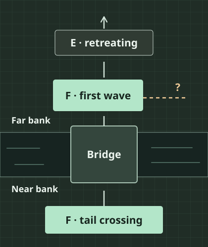

# Chokes, Bridges, Gates, and Doors

## Core rule

Crossing is not finished when the first players survive. It is finished when the zerg spreads, stabilizes, helps the next wave through, and prevents the counter path.

## Crossing sequence

A clean crossing often needs:

1. caller identifies the crossing intent
2. tanks check or stop counter angles
3. supports prepare the danger lane
4. healers cover the crossing and tail
5. first players through spread into useful space
6. DPS already through turn and Q/W
7. tanks/supports help the next wave through
8. zerg either holds, pushes, or resets with intent

## Common failure pattern

The first wave crosses and keeps running. The second wave gets bombed. The first wave is alive but useless.

Better pattern:

> Cross, spread, turn, heal, shield, wall, Q/W, and help the next wave.

## Door and gate defense

When defending a gate or door:

- tanks should hold the actual entry path
- ranged players should pressure from safe lines
- supports should know the enemy bomb package
- healers should cover the likely impact, not only the safest group
- unnecessary side walls or side angles should be abandoned if they only create danger

## Walking into them

Sometimes walking into or through a spent enemy is safer than backing into a choke. This is not a universal rule. It requires reading:

- enemy cooldowns spent
- friendly support/healing connected
- enemy path blocked or awkward
- your back path worse than forward path

## Field exercise — the bridge crossing

Your first wave has crossed. Enemies are retreating ahead, an approach on the right is unscouted, and your tail is still on the bridge.

**Legend:** F = friendly group; E = observed enemy movement; ? = information missing. Solid lines show the crossing; dashed lines indicate an unscouted approach. Positions are illustrative, not a map, range or timing measurement.

**Complete text equivalent:** Read from bottom to top. The friendly tail remains on the near bank and bridge. The friendly first wave is on the far bank. Enemies ahead are moving away from it. A side route joins the far bank from the right; no scout has confirmed what is there. Advancing the first wave would increase separation from the tail while leaving that route unchecked.

## Choose before reading the explanation

??? question "Chase the retreating enemies"

    This may exploit a real opportunity, but the retreat alone does not establish safety. The first wave could lose support or meet another threat from the side. Identify the observation that would justify that risk before committing.

??? question "Cover the crossing and check the side route"

    With the stated information, this preserves recovery while improving the next decision. Keep reachable pressure, cover the remaining crossing and ask for a side-route report. Do not turn a temporary hold into indefinite waiting if an objective deadline changes the cost.

??? question "Abandon the crossing"

    A new enemy wave or lost recovery route could justify withdrawal. The current uncertainty alone does not prove retreat is best. Check whether returning would compress your own groups on the bridge.

## Change one fact

The side route is confirmed clear and the tail has crossed. What now makes advancing more plausible? If a fresh threat arrives instead, what position preserves recovery?

## Training prompt

On every choke death, ask:

- Was the player first wave, middle wave, or tail?
- Did safe players help the next wave?
- Did tanks stop the counter path?
- Did healers heal the danger side?
- Did supports place tools on the crossing lane?

## Related pages

- [Spread Does Not Mean Leave the Fight](../fight-execution/spread-does-not-mean-leave.md)
- [Healer Guide](../roles/healers.md)
- [Defensive / Stopper Tanks](../roles/stopper-tanks.md)

## Related Library references

- [Terrain and Geometry](../fight-concepts/terrain-geometry.md)
- [Objective Door Fights](../practical-examples/objective-door-fights.md)
- [Movement and Positioning](../fight-concepts/movement-positioning.md)
